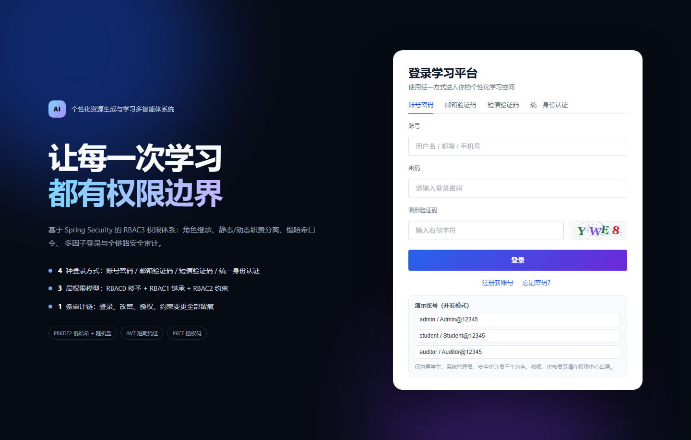
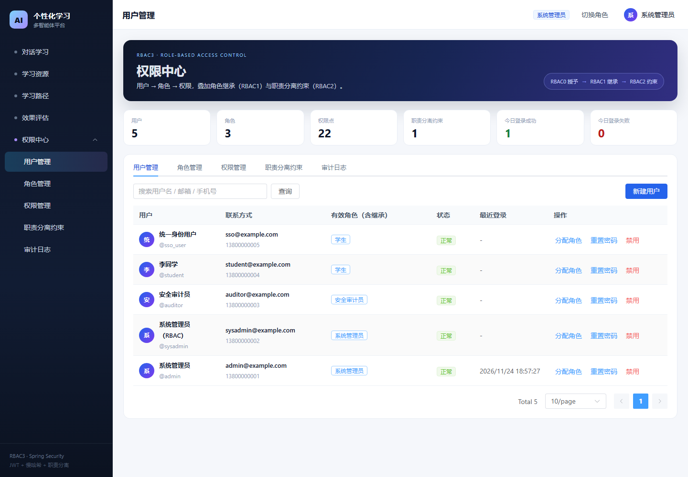

# 个性化资源生成与学习多智能体系统

基于 **多智能体 + 大模型** 的个性化学习平台。通过对话式画像、多智能体资源生成、个性化学习路径规划、智能辅导与效果评估，为学生提供全方位的学习支持。

## 功能模块

| 模块 | 说明 | 状态 |
|------|------|------|
| 对话式学习画像 | 自然语言抽取 ≥6 个维度的动态学生画像，随学随新 | 骨架 |
| 多智能体资源生成 | 文档 / 思维导图 / 题库 / 拓展阅读 / 视频脚本 / 代码案例 6 类 Agent 协作生成 | 骨架 |
| 个性化学习路径 | 基于知识图谱拓扑排序 + 画像匹配资源推荐 | 骨架 |
| 智能辅导 | 概念 / 计算 / 代码三类问题的多模态解答 | 骨架 |
| 学习效果评估 | 周评估 + 画像回写 + 路径动态调整 | 骨架 |
| **RBAC3 身份认证与权限管理** | 4 种登录方式、图形验证码、注册/找回密码、角色继承、SSD/DSD 约束、审计 | 可用 |

## RBAC3 权限模块预览

登录页支持账号密码 / 邮箱验证码 / 短信验证码 / 统一身份认证四种方式；权限中心覆盖用户、角色继承、权限点、SSD/DSD 约束与审计日志。





详细设计与演示账号见 [RBAC3 设计](docs/rbac3-design.md)。

## 技术栈

- 后端：Java 21 + Spring Boot 3.3 + Spring Security（JWT / Method Security）+ Spring Data JPA + Qdrant + Neo4j + Redis + RabbitMQ
- 前端：Vue3 + Vite + Pinia + Element Plus + WebSocket 进度推送
- 基础设施：PostgreSQL / Redis / RabbitMQ / Neo4j / Qdrant（docker-compose 一键启动）

## 快速开始

### 方式一：一键启动脚本

```bash
# Windows
run.bat

# Linux/Mac
chmod +x run.sh && ./run.sh
```

### 方式二：手动启动

```bash
# 1. 启动基础设施
docker compose -f docker/docker-compose.yml up -d postgres redis rabbitmq neo4j qdrant

# 2. 配置环境变量
export OPENAI_API_KEY=sk-xxxx   # 你的 OpenAI 或兼容 API Key

# 3. 启动后端（需 JDK 21 + Maven 3.9+）
cd backend
mvn spring-boot:run

# 4. 启动前端（需 Node 20+）
cd frontend
npm install
npm run dev
```

访问 `http://localhost:5173`。

### 方式三：RBAC3 独立演示（H2，无需 PostgreSQL/Redis/Neo4j/RabbitMQ）

```bash
cd backend
mvn spring-boot:run -Dspring-boot.run.profiles=rbac-demo
```

该 profile 使用 H2，并排除 Redis/Neo4j/RabbitMQ 自动配置，无需启动任何中间件；
登录与权限中心接口可直接使用（主应用其余接口仍可能需要完整基础设施）。

另开终端启动前端，并把代理指向 8081：

```bash
cd frontend
npm install
# Windows PowerShell
$env:VITE_API_TARGET="http://localhost:8081"
npm run dev
# Linux/macOS: VITE_API_TARGET=http://localhost:8081 npm run dev
```

首次启动自动建表并写入演示账号。内置角色只保留 **学生、系统管理员、安全审计员** 三个，
教师/审核员/发布员等业务角色请登录 `admin / Admin@12345` 后在权限中心自行创建。
完整模型见 [RBAC3 设计](docs/rbac3-design.md)。

### Docker 完整部署

```bash
docker compose -f docker/docker-compose.yml up -d
# 前端: http://localhost:80
# 后端: http://localhost:8080
```

## 文档索引

| 文档 | 说明 |
|------|------|
| [架构设计](docs/architecture.md) | 系统架构、分层规则、多智能体编排协议、画像规范、路径算法、技术选型 |
| [开发规范](docs/dev-guide.md) | 工程环境、命名规范、编码约定、分层禁止项、Review 清单 |
| [API 接口规范](docs/api-spec.md) | 10 个接口定义、请求/响应示例、WebSocket 进度推送、状态码 |
| [数据字典](docs/data-dictionary.md) | 业务表 + `auth_*` RBAC 表结构、列约束、索引设计、关联关系 |
| [RBAC3 设计](docs/rbac3-design.md) | 认证流程、RBAC0/1/2 模型、SSD/DSD、API、演示账号、作业对照 |
| [Git 协作规范](docs/git-guide.md) | 分支模型、提交规范、PR 规范、工作流示例 |
| [成文标准](docs/成文标准.md) | 五类文档的质量要求与评分对照表 |

## 目录结构

```
learning-agent-system/
├── backend/                             # Spring Boot 后端
│   ├── pom.xml                          # Maven 依赖（Spring AI + JPA + Redis + ...）
│   └── src/main/
│       ├── java/.../
│       │   ├── agent/                   # ★ 多智能体层（9 个 Agent + Orchestrator）
│       │   │   ├── BaseAgent.java       #   抽象基类：LLM 调用/重试/兜底
│       │   │   ├── Orchestrator.java    #   虚拟线程并行编排核心
│       │   │   ├── Designer/Doc/Mindmap/Quiz/Reading/Script/Coder Agent
│       │   │   ├── ProfileAgent.java    #   画像抽取
│       │   │   ├── TutorAgent.java      #   智能辅导（加分）
│       │   │   └── product/             #   8 个产物 Record（Agent 间传递）
│       │   ├── config/                  # 配置层
│       │   │   ├── LlmConfig.java       #   ChatClient 双模型配置
│       │   │   ├── AsyncConfig.java     #   虚拟线程执行器
│       │   │   ├── PromptLoader.java    #   Prompt 热更新加载器
│       │   │   ├── WebSocketConfig.java #   WebSocket 进度端点
│       │   │   └── TaskProgressBroadcaster.java  # 进度广播服务
│       │   ├── controller/              # 8 个 REST Controller
│       │   ├── dto/                     # 4 个请求 + 3 个响应 Record
│       │   ├── entity/                  # 9 个 JPA Entity
│       │   ├── repository/              # 8 个 Spring Data 接口
│       │   ├── service/                 # 8 个 Service（Profile/Path/Resource/Tutor/...）
│       │   ├── job/                     # 3 个定时任务骨架
│       │   ├── auth/                    # ★ RBAC3 认证与授权模块
│       │   │   ├── config/              #   SecurityConfig / JWT / 初始化
│       │   │   ├── controller/          #   登录、注册、找回密码、管理端
│       │   │   ├── entity/repository/   #   用户/角色/权限/闭包/约束/审计
│       │   │   ├── service/             #   慢哈希、验证码、令牌、RBAC 查询
│       │   │   └── security/            #   PasswordEncoder / JWT / 401/403
│       │   └── common/                  # ApiResult / BizException / 全局异常处理
│       └── resources/
│           ├── application.yml          # 数据库/Redis/Neo4j/Qdrant/Spring AI 配置
│           ├── application-rbac-demo.yml# H2 独立演示配置
│           └── prompt/                  # 9 个 Prompt 模板（.md，支持热更新）
│
├── frontend/                            # Vue3 + Vite 前端
│   ├── package.json / vite.config.js / index.html
│   └── src/
│       ├── views/                       # Chat / Resources / PathMap / Dashboard
│       │   ├── auth/                    # 登录 / 注册 / 找回密码 / SSO 回调
│       │   └── admin/                   # 用户 / 角色 / 权限 / 约束 / 审计
│       ├── components/                  # ProgressBar / MindmapViewer / CodeBlock / QuizCard / PathTimeline / WsProgress
│       ├── stores/                      # Pinia: chat / resource / path / assessment / auth
│       ├── api/                         # Axios 封装 + 业务/认证/RBAC API
│       ├── router/                      # Vue Router 路由 + 登录/权限守卫
│       └── styles/                      # 全局样式
│
├── docker/                              # 基础设施 + 应用部署
│   ├── docker-compose.yml               # 7 个服务（PG/Redis/RabbitMQ/Neo4j/Qdrant + 后端/前端）
│   ├── Dockerfile.backend
│   └── Dockerfile.frontend + nginx.conf
│
├── docs/                                # 标准规范文档（8 份）
│   ├── architecture.md                  # 架构设计
│   ├── dev-guide.md                     # 开发规范
│   ├── api-spec.md                      # API 接口规范
│   ├── data-dictionary.md               # 数据字典
│   ├── rbac3-design.md                  # RBAC3 身份认证与权限设计
│   ├── rbac3-branch-push.md             # 分支推送指南
│   ├── git-guide.md                     # Git 协作规范
│   ├── screenshots/rbac/                # 登录/权限中心截图
│   └── 成文标准.md                       # 文档质量标准
│
├── run.bat / run.sh                     # 一键启动脚本
├── README.md
└── .gitignore
```

## 开发验证

```bash
# 后端编译检查（需 JDK 21）
cd backend && mvn -q compile

# 前端编译检查
cd frontend && npm run build

# 运行测试
cd backend && mvn test
```

## 已知待办

| 项目 | 说明 |
|------|------|
| Neo4j 真实图谱 | 替换 KnowledgeGraphService 中的内存示例图 |
| Qdrant 向量入库 | ResourceService.save() 中补充向量编码逻辑 |
| 画像路径写入 | ProfileService.setAtPath() 实现 |
| 数据库迁移 | 引入 Flyway/Liquibase 管理 DDL |
| Swagger | 集成 springdoc-openapi 自动生成接口文档 |