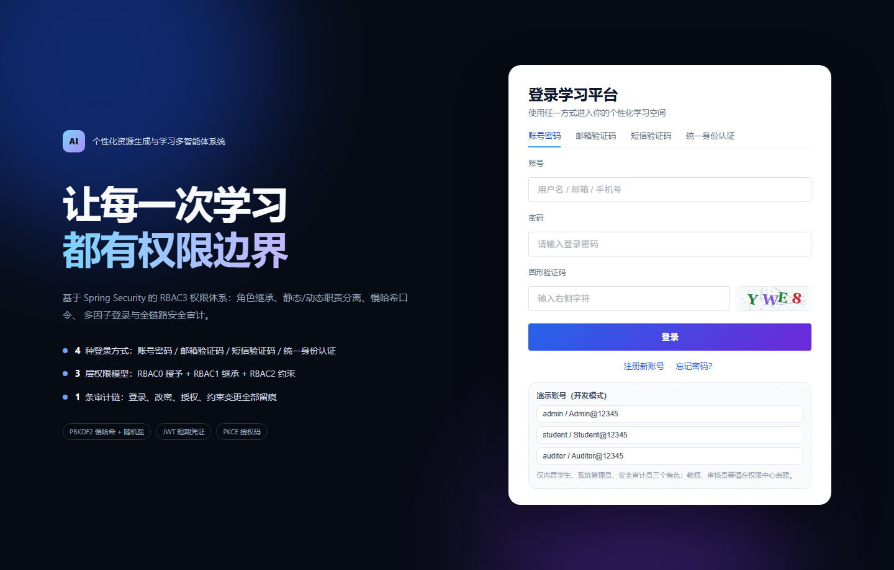
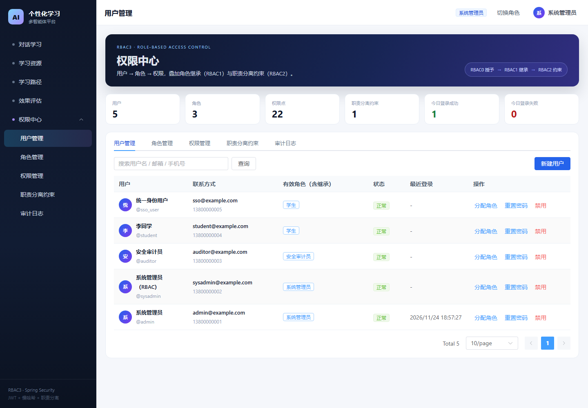
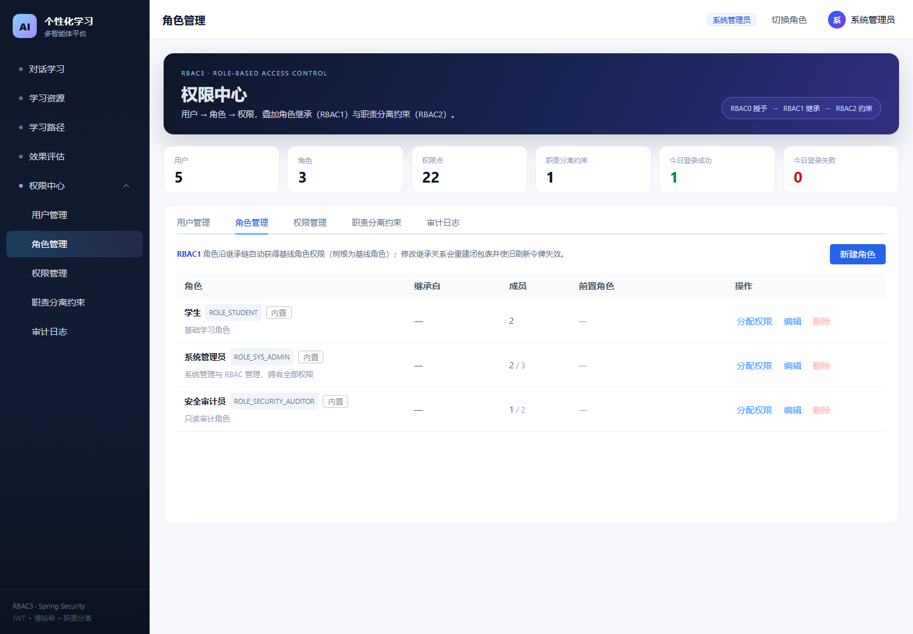

# RBAC3 身份认证与权限管理设计

> 对应课程作业：**鉴权和授权用框架写**；覆盖图片中的 5 条登录/注册要求，并在 RBAC0 基础上实现 RBAC1 角色继承与 RBAC2 职责分离约束，合称 RBAC3。

## 界面预览

**登录页**：4 种登录方式、SVG 图形验证码、演示账号一键填充。



**权限中心**：用户管理（有效角色含继承）、角色继承树、职责分离约束、审计日志。





## 1. 目标与边界

- 在现有「个性化资源生成与学习多智能体系统」中新增独立 `auth` 模块，不侵入原有学习业务。
- 认证交给 **Spring Security**（`SecurityFilterChain`、`DaoAuthenticationProvider`、`AuthenticationManager`、JWT Resource Server）。
- 授权交给 **Spring Security Method Security**（`@PreAuthorize` + JWT 中的 `perms` Authority）。
- 数据使用 **Spring Data JPA**，与现有 PostgreSQL 部署一致；测试/演示用 H2。
- 前端使用现有 **Vue3 + Element Plus**，新增登录、注册、找回密码、权限中心页面。

## 2. 权限模型（RBAC3）

### 2.1 模型组成

| 层 | 能力 | 本系统实现 |
| --- | --- | --- |
| RBAC0 | 用户-角色-权限授予 | `auth_user_role`、`auth_role_permission` |
| RBAC1 | 角色继承 | `auth_role.parent_id`（继承自的基线角色）+ `auth_role_closure` 闭包表 |
| RBAC2 | 约束 | SSD/DSD（`auth_constraint`）、角色基数 `max_members`、前置角色 `required_role_id` |
| RBAC3 | RBAC1 + RBAC2 合并 | 继承后的有效角色参与 SSD/DSD 校验 |

### 2.2 继承方向

采用「派生角色继承基线角色权限」：`auth_role.parent_id` 指向被继承的基线角色。

默认只内置三个互不继承的基线角色：

```text
ROLE_STUDENT          学生（学习基础权限）
ROLE_SYS_ADMIN        系统管理员（全部权限，用于创建/授权其他角色）
ROLE_SECURITY_AUDITOR 安全审计员（只读审计）
```

管理员可在权限中心创建派生角色，例如：

```text
ROLE_STUDENT
  └─ ROLE_CUSTOM_TEACHER（继承学生）
       └─ ROLE_CUSTOM_REVIEWER（继承教师）
```

- 用户直接授予 `ROLE_CUSTOM_REVIEWER` 后，有效角色为 `CUSTOM_REVIEWER + CUSTOM_TEACHER + STUDENT`。
- 闭包表每行 `(ancestor_id, descendant_id, depth)` 表示「拥有 ancestor 即获得 descendant」；查询用户有效角色只需一次 JOIN。
- 任何继承关系变更都会重建闭包，并递增所有用户 `token_version`，使旧刷新令牌失效。
- 管理端角色树以基线角色为根、派生角色为子节点展示；表格「继承自」列即 `parent_id`。

### 2.3 约束语义

| 约束 | 触发时机 | 规则 |
| --- | --- | --- |
| SSD 静态职责分离 | 管理员给用户分配角色时 | 用户**有效角色**（含继承）在同一 SSD 集合中的数量 ≤ `max_roles` |
| DSD 动态职责分离 | 登录、刷新、切换激活角色时 | 本次会话**激活角色**展开继承后，在同一 DSD 集合中的数量 ≤ `max_roles` |
| 角色基数 | 分配角色时 | 角色直接成员数不得超过 `max_members` |
| 前置角色 | 分配角色时 | 必须先拥有 `required_role_id` 指定的角色 |
| 用户角色数 | 分配角色时 | 默认最多 8 个直接角色（`app.auth.rbac.max-roles-per-user`） |

内置约束只保留：

- `SSD_ADMIN_AUDITOR`：系统管理员与安全审计员互斥（阈值 1）。

DSD 不再内置：管理员创建两个互斥业务角色后，可在「职责分离约束」页新建 DSD 约束，
例如审核员/发布员在单次会话中择一激活。

DSD 冲突返回业务码 `40901`，`data` 中带 `options`（用户可激活角色），前端弹出角色选择框，用户选择后重新签发令牌。

## 3. 认证流程

### 3.1 账号密码登录（图片第 1 条）

```text
浏览器                 AuthController          Spring Security              DB
  │  POST /login/password    │                       │                       │
  ├─────────────────────────>│ 1. 校验图形验证码      │                       │
  │                          ├──────────────────────>│ 2. AuthenticationManager
  │                          │                       ├─ UserDetailsService ─>│ 查用户
  │                          │                       │  取 salt + hash       │
  │                          │                       ├─ PasswordEncoder      │
  │                          │                       │  PBKDF2 重算 + 常量时间比对
  │                          │                       │                       │
  │                          │ 3. 有效角色 + DSD 校验 │                       │
  │                          │ 4. 签发 JWT + 刷新令牌 │                       │
  │<─────────────────────────┤ 5. HttpOnly Cookie     │                       │
```

- 密码：PBKDF2-HMAC-SHA256，迭代 210,000 次，每用户 16 字节随机盐；数据库分列保存 `password_salt` / `password_hash`。
- 未知账号：`DaoAuthenticationProvider` 仍执行一次等价慢哈希，避免账号枚举与时序侧信道。
- 失败：统一返回 `40101 账号或密码错误`；连续 5 次失败锁定 15 分钟。
- 成功：访问令牌 15 分钟；刷新令牌 7 天，仅存 SHA-256 摘要，HttpOnly + SameSite=Lax。

### 3.2 邮箱 / 短信验证码登录（图片第 2、3 条）

- `POST /api/auth/otp/send`：场景 `LOGIN / REGISTER / FORGOT`，渠道 `EMAIL / SMS`。
- 6 位验证码只保存 HMAC-SHA256 摘要，5 分钟有效、60 秒重发冷却、最多 5 次尝试、每小时最多 8 次。
- 开发模式：返回 `debugCode` 并写入内存发件箱 `GET /api/auth/dev/outbox`；生产环境替换为 SMTP / 短信网关，不返回验证码。
- 手机号校验：中国大陆 11 位 `1[3-9]\d{9}`，自动去除空格与 `+86` 前缀。

### 3.3 统一身份认证（图片第 2、3 条）

演示实现 OIDC 授权码 + PKCE S256：

1. 前端生成 `code_verifier` / `code_challenge` / `state`，跳转 `/api/auth/sso/authorize`。
2. 演示 IdP 校验 `client_id`、`redirect_uri` 白名单、`state`、`S256`，自动同意并把一次性 `code` 302 回前端。
3. 前端 `/sso/callback` 校验 `state`，携带 `code_verifier` 调用 `/api/auth/sso/token`。
4. 后端校验 PKCE、`client_id`、`redirect_uri`、code 一次性与 60 秒有效期，通过 `auth_identity(provider, subject)` 映射本地用户并签发会话。

生产替换点：将 `/authorize` 换成真实 IdP 登录页，`/token` 改为校验 IdP `id_token` 的签名、`iss`、`aud`、`nonce`；本地只保留身份映射与会话签发。

### 3.4 图形验证码（图片第 4 条）

- `GET /api/auth/captcha` 返回 4 位 SVG（Base64 data URI）。
- 服务端 Caffeine 缓存 2 分钟，一次有效；密码登录、注册、找回密码强制校验。
- 验证码字符去除易混淆的 `I/O/0/1`，带干扰线、噪点与随机旋转。

### 3.5 注册与找回密码（图片第 5 条）

- 注册：图形验证码 + 邮箱验证码 + 用户名/邮箱/手机号唯一 + 口令强度（≥10 位，四类字符至少三类，不含用户名/邮箱前缀）。注册成功默认授予 `ROLE_STUDENT` 并自动登录。
- 找回密码：账号存在与否都返回同一句「如果该账号存在，我们已向绑定的邮箱/手机号发送验证码」；验证码一次性；重置成功后 `token_version + 1` 并吊销全部刷新令牌。
- 修改密码：校验原密码，成功后同样吊销全部刷新令牌。

## 4. 授权与审计

### 4.1 接口鉴权

- JWT 的 `perms` 声明在 `JwtAuthenticationConverter` 中映射为 `GrantedAuthority`。
- 管理端接口逐方法声明：

```java
@PreAuthorize("hasAuthority('rbac:role:write')")
```

- 权限编码形如 `resource:review`、`rbac:user:write`，内置 24 个权限点，分为菜单/接口/按钮三类。

### 4.2 审计

`auth_audit_log` 记录：登录成功/失败/锁定、注册、找回/修改密码、刷新令牌、注销、角色创建/更新/删除/授权、用户角色变更、约束变更、角色切换、账号启停/解锁。

管理端 `GET /api/admin/audit` 支持按事件类型、用户名、成功/失败、时间范围分页检索。

## 5. 数据表

| 表 | 说明 |
| --- | --- |
| `auth_user` | 用户、salt/hash、状态、失败次数、锁定时间、token_version |
| `auth_role` | 角色、继承自的基线角色、成员上限、前置角色 |
| `auth_permission` | 权限点、类型、父节点 |
| `auth_user_role` | 用户-角色授予 |
| `auth_role_permission` | 角色-权限授予 |
| `auth_role_closure` | 角色继承闭包 |
| `auth_constraint` | SSD/DSD 约束 |
| `auth_constraint_role` | 约束-角色成员 |
| `auth_refresh_token` | 刷新令牌摘要、激活角色、版本、吊销 |
| `auth_audit_log` | 安全审计 |
| `auth_identity` | 外部统一身份映射 |

## 6. API 一览

| 方法 | 路径 | 说明 |
| --- | --- | --- |
| GET | `/api/auth/captcha` | 图形验证码 |
| GET | `/api/auth/providers` | 登录方式探测 |
| POST | `/api/auth/login/password` | 账号密码登录 |
| POST | `/api/auth/login/otp` | 邮箱/短信验证码登录 |
| POST | `/api/auth/otp/send` | 发送验证码 |
| GET | `/api/auth/sso/authorize` | OIDC 授权端点（302） |
| POST | `/api/auth/sso/token` | 授权码换会话 |
| POST | `/api/auth/register` | 注册 |
| POST | `/api/auth/forgot` | 申请找回密码 |
| POST | `/api/auth/reset` | 重置密码 |
| POST | `/api/auth/refresh` | 轮换刷新令牌 |
| POST | `/api/auth/logout` | 注销 |
| GET | `/api/auth/me` | 当前用户/角色/权限 |
| PUT | `/api/auth/password` | 修改密码 |
| POST | `/api/auth/session/roles` | 切换激活角色 |
| GET | `/api/admin/overview` | 权限中心概览 |
| GET/POST | `/api/admin/users` | 用户列表/创建 |
| PUT | `/api/admin/users/{id}/roles` | 分配角色（SSD/基数/前置校验） |
| PUT | `/api/admin/users/{id}/status` | 启用/禁用 |
| PUT | `/api/admin/users/{id}/password` | 管理员重置密码 |
| GET/POST | `/api/admin/roles` | 角色列表/创建 |
| GET | `/api/admin/roles/tree` | 角色继承树 |
| PUT/DELETE | `/api/admin/roles/{id}` | 更新/删除角色 |
| GET/PUT | `/api/admin/roles/{id}/permissions` | 角色权限 |
| GET/POST | `/api/admin/permissions` | 权限树/创建 |
| PUT/DELETE | `/api/admin/permissions/{id}` | 更新/删除权限 |
| GET/POST | `/api/admin/constraints` | 约束列表/创建 |
| PUT/DELETE | `/api/admin/constraints/{id}` | 更新/删除约束 |
| GET | `/api/admin/audit` | 审计检索 |

## 7. 演示账号

| 账号 | 密码 | 角色 | 用途 |
| --- | --- | --- | --- |
| `admin` | `Admin@12345` | 系统管理员 | 全部权限，创建/授权自定义角色 |
| `sysadmin` | `SysAdmin@12345` | 系统管理员 | RBAC 管理备用账号 |
| `auditor` | `Auditor@12345` | 安全审计员 | 只读审计/约束 |
| `student` | `Student@12345` | 学生 | 基础学习 |
| `sso_user` | `Sso@12345` | 学生 | 统一身份认证映射 |

内置角色只有 **学生、系统管理员、安全审计员** 三个。教师、审核员、发布员、运营等角色
不再内置，登录 `admin` 后在「角色管理 → 新建角色」自行创建并分配权限。

## 8. 运行方式

### 8.1 集成到主应用（PostgreSQL）

```bash
docker compose -f docker/docker-compose.yml up -d postgres
cd backend
mvn spring-boot:run
cd ../frontend
npm install && npm run dev
```

首次启动自动建表并写入内置角色/权限/演示账号（仅当 `auth_role` 为空）。

### 8.2 独立 RBAC 演示（H2，无需外部中间件）

```bash
cd backend
mvn spring-boot:run -Dspring-boot.run.profiles=rbac-demo
```

`rbac-demo` profile 使用 H2，并在 `spring.autoconfigure.exclude` 中关闭 Redis/Neo4j/RabbitMQ；
启动的是主应用，登录/RBAC 接口不依赖外部中间件。后端 `http://localhost:8081`；前端：

```bash
cd frontend
npm install
set VITE_API_TARGET=http://localhost:8081   # PowerShell: $env:VITE_API_TARGET="http://localhost:8081"
npm run dev
```

打开 `http://localhost:5173`。

## 9. 作业要求对照

| 图片要求 | 落点 |
| --- | --- |
| 登录流程：提交密码→查用户取盐+哈希→慢哈希重算比对→签发会话凭证→失败统一提示 | `AuthController` → `AuthenticationManager` → `AuthUserDetailsService` + `SaltedPasswordEncoder` + `PasswordService` → `TokenService`；失败统一 `40101` |
| 统一身份认证和手机号验证的技术栈 | Spring Security OAuth2 Resource Server / Nimbus JWT；OIDC 授权码 + PKCE；手机号 HMAC OTP + 短信网关替换点 |
| 每个组至少两种登录方式 | 4 种：账号密码、邮箱验证码、短信验证码、统一身份认证 |
| 登录验证码至少一种形式 | SVG 图形验证码，一次有效 |
| 注册、忘记密码及提示信息 | 注册 + 邮箱验证码；找回密码统一提示防枚举 |
| 鉴权和授权用框架写 | Spring Security 过滤器链 + Method Security + JPA |

## 10. 生产化清单

- 覆盖 `JWT_SECRET`、`SSO_CLIENT_SECRET`；关闭 `app.auth.dev-mode`；开启 `secure-cookie`。
- 用 Redis 替换 Caffeine（验证码、限流、SSO code），支持多实例。
- 接入真实 SMTP/短信网关；补充邮件模板与频控。
- 接入真实 IdP，校验 `id_token` 签名/issuer/audience/nonce，删除演示自动同意。
- 为 `auth_*` 表增加 Flyway/Liquibase 迁移与索引评审。
- 将现有业务接口逐步纳入 `@PreAuthorize`，当前为兼容旧前端仅保护 `/api/auth/**`、`/api/admin/**`。
- 增加登录风控（设备指纹、异地提醒）、审计日志归档与告警。
