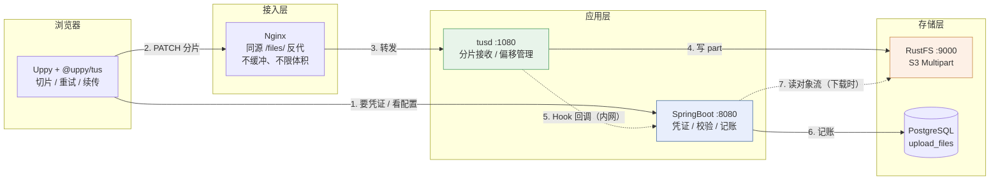
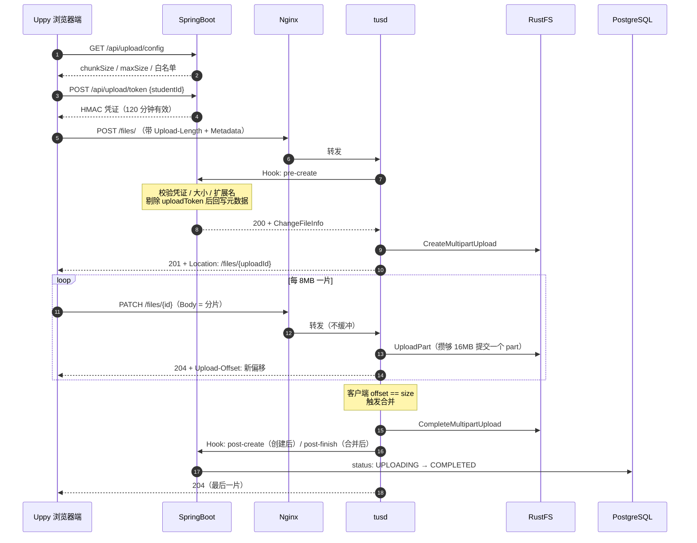
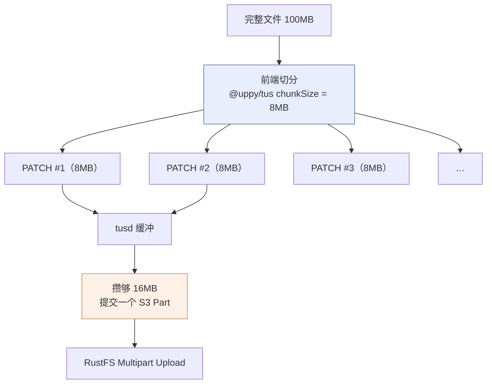
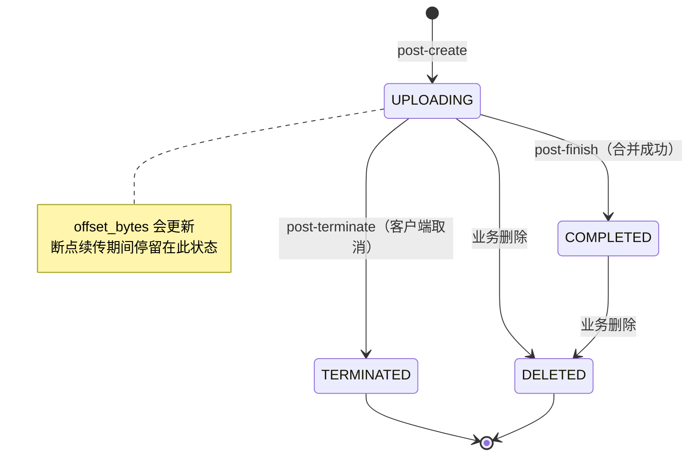
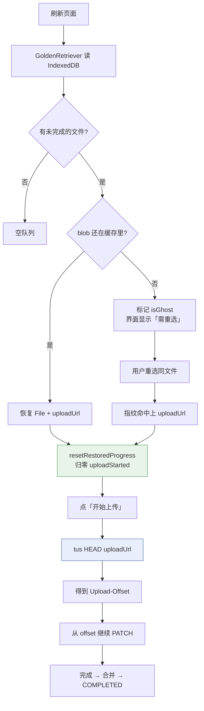

# 文件上传系统详解（tus + Uppy + tusd + RustFS）

| 项 | 内容 |
|----|------|
| 版本 | v1.0 |
| 日期 | 2026-11-20 |
| 状态 | 正式 |
| 适用读者 | 需要理解/讲授本项目上传链路的团队成员、课程同学 |
| 配套文档 | [upload-design.md](upload-design.md)（设计与排错）、[api-spec.md](api-spec.md)、[data-dictionary.md](data-dictionary.md) |

---

## 目录

1. [先搞清楚要解决什么问题](#1-先搞清楚要解决什么问题)
2. [技术选型：为什么是 tus](#2-技术选型为什么是-tus)
3. [整体架构与一次上传的完整链路](#3-整体架构与一次上传的完整链路)
4. [tus 协议精讲](#4-tus-协议精讲)
5. [两层分片：前端 8MB 与后端 16MB](#5-两层分片前端-8mb-与后端-16mb)
6. [前端实现逐段拆解](#6-前端实现逐段拆解)
7. [tusd 配置逐条解释](#7-tusd-配置逐条解释)
8. [SpringBoot Hook：四个事件的分工](#8-springboot-hook四个事件的分工)
9. [数据模型与状态机](#9-数据模型与状态机)
10. [断点续传的三层机制](#10-断点续传的三层机制)
11. [安全设计](#11-安全设计)
12. [踩坑实录（教学重点）](#12-踩坑实录教学重点)
13. [课堂演示脚本](#13-课堂演示脚本)
14. [高频提问 Q&A](#14-高频提问-qa)
15. [变更记录](#15-变更记录)

---

## 1. 先搞清楚要解决什么问题

讲这套系统，一定要**从需求倒着讲**，否则听众会觉得「一个上传为什么要五个组件」。

需求是这样的：

| 编号 | 需求 | 隐含的技术约束 |
|------|------|----------------|
| R1 | 学生一次能选一批文件（课件、视频、截图）上传 | 需要并发控制，不能开 100 个连接 |
| R2 | 单个文件可能到 GB 级（录屏、教学视频） | **不能**把整个文件读进内存；HTTP 请求体上限要放开 |
| R3 | 网络抖动/关页面/切 WiFi 后能接着传，不从头来 | 必须能向服务端询问「你收到多少字节了」 |
| R4 | 上传不能拖垮业务服务 | 字节流**不经过** SpringBoot |
| R5 | 服务端要能做权限、大小、类型校验 | 需要在上传开始前拦截 |
| R6 | 上传完要能下载、能删、能列出来 | 需要元数据入库 |

这六条里，R2 和 R3 是**架构性约束**——它们直接排除了「一个 POST 把文件传完」的做法。后面所有组件的存在，都是为了满足这两条。

### 一句话概括这套方案

> 浏览器用 **tus 协议**把文件切成小片，一片一片发给 **tusd**；tusd 每收到一片就转手写进 **RustFS** 的 S3 Multipart Upload；分片在对象存储内部合并，前端和 tusd 都**不持有完整文件**；**SpringBoot** 只在四个关键节点被 tusd 回调一次，负责校验和记账。

记住这句话，后面所有细节都是它的展开。

---

## 2. 技术选型：为什么是 tus

### 2.1 三种常见做法对比

| 方案 | 断点续传 | 服务端内存 | 业务服务负载 | 实现复杂度 | 结论 |
|------|----------|------------|--------------|------------|------|
| 普通 `POST` 一次传完 | ❌ 断了就重传 | 高（要缓冲） | 高（字节流过业务） | 低 | 大文件不可用 |
| 前端切片 + 自己写合并接口 | ✅ 需自己做 | 中 | 高（合并要过业务） | 高（要自己处理分片乱序、幂等、清理） | 重复造轮子 |
| S3 预签名直传 | ⚠️ 需自己拼 part | 低 | 低 | 中高 | 客户端要懂 S3 协议 |
| **tus 协议 + tusd** | ✅ 协议原生支持 | **低** | **低** | 中 | ✅ 选它 |

### 2.2 tus 到底解决了什么

tus 是一个**基于 HTTP 的可恢复上传协议**，它把「续传」这件事标准化成了四个动作：

```
POST   创建一个上传，服务端返回一个 URL
PATCH  往这个 URL 追加一段字节，服务端告诉你现在收到多少了
HEAD   问这个 URL：你收到多少字节了？
DELETE 取消这次上传，把已收的分片清掉
```

就这四个。**核心是 `HEAD` 返回的 `Upload-Offset`** —— 客户端不需要自己记账，每次续传前问一下服务端就行。

这一点非常关键：**进度的事实来源在服务端，不在浏览器**。理解了这句话，第 10 节讲断点续传就不会有疑惑。

### 2.3 为什么用 tusd 而不是自己实现

tusd 是 tus 协议的官方 Go 实现，它替我们做了三件脏活：

1. **分片存储与偏移管理**：处理 PATCH 的乱序、并发、幂等
2. **对接后端存储**：`-s3-*` 参数直接让它把分片写成 S3 Multipart Upload
3. **Hook 回调**：在关键节点回调我们的业务服务

如果自己实现，你得处理「两个 PATCH 同时到达」「分片乱序」「客户端传了 0 字节」「续传时 offset 对不上」这些边界情况——这些正是 tusd 存在的意义。

---

## 3. 整体架构与一次上传的完整链路

### 3.1 部署拓扑



**这张图要讲透三个「不」**：

1. **浏览器的文件字节不经过 SpringBoot** —— 只走 Nginx → tusd
2. **tusd 也不落完整文件** —— 它每收一片就写进 RustFS 的 part，内存里只有缓冲区
3. **SpringBoot 不参与字节流** —— 它只在 Hook 里被回调，做校验和记账

### 3.2 一次上传的完整时序



**教学提示**：这张时序图上有三个容易被忽略的点，讲的时候要停下来强调：

- `post-create` 是**收到 POST 之后**触发的，此时数据库就已经有 `UPLOADING` 记录了 —— 所以中途放弃的上传会留下 `UPLOADING` 残留
- 每个 PATCH 的响应里都带 `Upload-Offset`，这是前端更新进度条的依据
- **合并发生在 tusd 内部**，前端从头到尾没参与合并

---

## 4. tus 协议精讲

### 4.1 四个动词与核心 Header

| 动作 | 方法 | 关键请求头 | 关键响应头/状态 |
|------|------|-----------|-----------------|
| 创建 | `POST /files/` | `Upload-Length`、`Upload-Metadata` | `201` + `Location` |
| 追加 | `PATCH /files/{id}` | `Upload-Offset`、`Content-Type: application/offset+octet-stream` | `204` + `Upload-Offset` |
| 查询 | `HEAD /files/{id}` | — | `200` + `Upload-Offset`、`Upload-Length` |
| 终止 | `DELETE /files/{id}` | — | `204` |

所有请求都必须带 `Tus-Resumable: 1.0.0`，这是协议版本协商。

### 4.2 `Upload-Offset` 是整个协议的灵魂

```http
HEAD /files/abc123 HTTP/1.1
Tus-Resumable: 1.0.0

HTTP/1.1 200 OK
Upload-Offset: 16777216
Upload-Length: 25165824
```

读法：**「这个上传一共 25165824 字节，我已经收到 16777216 字节了，你从 16777216 开始发。」**

客户端续传时的逻辑就是三行：

```js
const res = await fetch(uploadUrl, { method: 'HEAD', headers: { 'Tus-Resumable': '1.0.0' } })
const offset = Number(res.headers.get('Upload-Offset'))
// 从 offset 开始发下一片
```

**这正是「刷新页面后还能续传」的全部秘密**——不需要浏览器记住任何东西，问服务端就行。

### 4.3 为什么 PATCH 而不是 PUT

`PUT` 的语义是「把资源整体替换成这个内容」，天然和「追加」冲突，而且不幂等。tus 用 `PATCH` + `application/offset+octet-stream` 明确表达「我是往指定偏移追加字节」。

这也带来一个约束：**PATCH 只能从服务端当前的 offset 开始发**。如果你发了个 offset 对不上的 PATCH，tusd 会返回 `409 Conflict`。

### 4.4 与 HTTP Range 的区别（常见误解）

有同学会问：HTTP 本身有 `Range` 头，为什么不用它续传？

| 维度 | HTTP Range | tus |
|------|-----------|-----|
| 语义 | 读/写**资源的某一段** | **向已上传部分追加** |
| 谁来记进度 | 客户端必须记住传到哪 | 服务端 `Upload-Offset` |
| 断点信息 | 要自己维护 | `HEAD` 一问就有 |
| 分片元数据 | 无 | `Upload-Metadata`（文件名、归属等） |
| 标准 | RFC 7233（读取为主） | 独立协议，专为上传设计 |

一句话：**Range 是「我要读第几段」，tus 是「我还要接着传多少」，后者才是上传场景需要的语义。**

---

## 5. 两层分片：前端 8MB 与后端 16MB

这是最容易被问倒的地方，必须讲清楚**为什么要有两层，而且数字不一样**。

### 5.1 两层分别是什么



| 层 | 单位 | 由谁决定 | 作用 |
|----|------|---------|------|
| 前端分片 | 8MB（`chunkSize`） | 浏览器，`@uppy/tus` | 决定**续传粒度**和进度更新频率 |
| S3 Part | 16MB（`-s3-part-size`） | tusd | 决定**对象存储内部**的存储单元 |

### 5.2 为什么前端是 8MB

分片大小是在权衡两件事：

| 分片太小（如 1MB） | 分片太大（如 64MB） |
|---|---|
| 请求数暴增，HTTP 头开销占比高 | 断一次要重传 64MB，用户体验差 |
| 但断了只丢 1MB，重传快 | 但进度条更新很卡顿 |
| 服务端 .info 写入频繁 | 内存缓冲压力大 |

8MB 是个经验值：100MB 文件 = 13 个请求，断点最多丢 8MB，进度条每 ~1 秒动一次（局域网）。本项目用 8MB 还有一个额外理由：**它是 S3 最小 part（5MB）的整数倍附近，便于 tusd 聚合**。

### 5.3 为什么 S3 Part 是 16MB

S3 Multipart 有两条硬规则：

1. **除最后一片，每个 part 不得小于 5MB**
2. **一次上传最多 10000 个 part**

第 2 条决定了 part 大小的下限：

```
能传的最大文件 = part 大小 × 10000
part = 5MB  → 上限 50GB
part = 16MB → 上限 160GB   ← 本项目
part = 64MB → 上限 640GB
```

而且 part 太小还有个副作用：`CompleteMultipartUpload` 请求体里要列出所有 part 的 ETag，part 越多这个请求越大。

16MB 也正好是前端 8MB 的**两倍**——tusd 攒两片提交一个 part，聚合逻辑最简单，不会出现「半片 part」的尴尬。

### 5.4 为什么不让前端直接发 16MB

能，但没必要。前端分片越小，断点粒度越细，用户重传代价越小。**「前端粒度小、后端粒度大」是刻意的分离**：

> 前端分片大小是为**用户体验**服务的，S3 part 大小是为**存储成本与上限**服务的，两者的目标不同，不该强行统一。

### 5.5 一个具体例子

100MB 文件，8MB 分片，16MB part：

```
PATCH 1..2  → 攒成 16MB → UploadPart #1
PATCH 3..4  → 攒成 16MB → UploadPart #2
...
PATCH 13    → 剩 4MB，作为最后一个 part（允许 <5MB）
CompleteMultipartUpload → 对象成型
```

如果传到 PATCH 7 断了：**RustFS 里已经有 3 个完整的 part**，续传时只需重发 PATCH 7 之后的内容。

---

## 6. 前端实现逐段拆解

文件：`frontend/src/views/Upload.vue`。这一节按「初始化 → 选文件 → 开始上传 → 进度 → 续传」的顺序讲。

### 6.1 初始化：为什么配置要从后端拉

```js
const res = await getUploadConfig()   // GET /api/upload/config
config.value = res.data               // { tusEndpoint, chunkSize, maxFileSize, allowedExtensions, maxConcurrentUploads }
```

**反模式（不要这样写）**：

```js
// ❌ 把 8MB、5GB、白名单硬编码在前端
chunkSize: 8 * 1024 * 1024
maxFileSize: 5 * 1024 * 1024 * 1024
allowedExtensions: ['pdf', 'doc', ...]
```

**为什么不行**：后端 `pre-create` 用的是 `app.upload.security.*` 配置做真实校验。如果前端硬编码，改了后端配置后，前端仍然按旧值放行 —— 用户会看到「明明前端说能传，服务端却拒绝」。**限制值的唯一事实来源必须是后端**。

### 6.2 Uppy 初始化：每个选项的意图

```js
uppy = new Uppy({
  id: 'resource-uploader',        // GoldenRetriever 用它当 IndexedDB 前缀，改名会导致旧恢复数据失效
  autoProceed: false,             // 让用户先攒一批再点「开始上传」
  allowMultipleUploadBatches: true, // 同一页面可多轮上传，不锁死
  restrictions: { maxFileSize, allowedFileTypes }
})

uppy.use(Tus, {
  endpoint: config.value.tusEndpoint,   // '/files/'，同源，走 Nginx
  chunkSize: config.value.chunkSize,    // 8MB：交给 tus 切片，不在本地合并
  limit: config.value.maxConcurrentUploads, // 3：同时最多 3 个文件
  retryDelays: [0, 1000, 3000, 5000, 10000],
  removeFingerprintOnSuccess: true,
  allowedMetaFields: ['name', 'type', 'studentId', 'uploadToken'],
  headers: () => (credential.token ? { 'X-Upload-Token': credential.token } : {})
})
```

逐个说清楚，教学时这几条都要展开：

| 选项 | 作用 | 踩过的坑 |
|------|------|---------|
| `endpoint: '/files/'` | 同源路径，浏览器不需要知道 tusd 地址 | 若写 `http://localhost:1080` 会跨域，且部署后端口不同 |
| `chunkSize` | **前端只切分、不合并** | 不设的话 tus 会一次 PATCH 整个文件，等于没分片 |
| `limit` | 文件级并发 | 设太大，单机出口带宽和 tusd 内存会被打满 |
| `allowedMetaFields` | 决定哪些 meta 会写进 `Upload-Metadata` | **漏掉 `name` 就不会发送 `filename`**，服务端 400（详见 12.1） |
| `removeFingerprintOnSuccess` | 成功后删掉 tus 的指纹记录 | 不删的话，同名文件二次上传会被误判成「已传完」 |

### 6.3 `allowedMetaFields` 为什么必须含 `name` 和 `type`（重点）

这是最容易踩的坑，值得单独讲。`@uppy/tus` 生成请求时大致是这样：

```js
// 简化示意
const meta = pickAllowed(file.meta, allowedMetaFields)   // 先按白名单过滤
const metadata = { filename: file.meta.name, ...meta }   // 再用「过滤后」的 meta 取 name
```

当白名单写成 `['studentId', 'uploadToken']` 时：

1. `file.meta.name` 存在，但**被白名单过滤掉了**
2. 后面从过滤结果里取 `name` → `undefined`
3. 请求里根本没有 `filename` 字段
4. 服务端 `sanitizeFileName(null)` → 抛 `400 缺少文件名`

**正确写法**：

```js
allowedMetaFields: ['name', 'type', 'studentId', 'uploadToken']
```

**记忆口诀**：`allowedMetaFields` 不只是「允许带哪些业务字段」，它还是 `filename`/`filetype` 的**上游数据源**。

### 6.4 凭证：为什么用 HMAC 而不是 session

```js
async function ensureToken(force = false) {
  const stillValid = credential.token && Date.now() < credential.expiresAt - 60 * 1000
  if (!force && stillValid) return credential.token
  // ...
  credential = { token: data.token, expiresAt: new Date(data.expiresAt).getTime() }
  uppy.setMeta({ studentId: String(studentId), uploadToken: data.token })
}
```

凭证格式（后端 `UploadTokenService`）：

```
v1.{studentId}.{expEpochSecond}.{base64url(HMAC-SHA256)}
```

设计要点：

- **无状态**：服务端不需要存 session，验签即可
- **提前 60 秒刷新**：避免「刚好过期」的边界
- **`uppy.setMeta` 会同步到所有已存在文件**：包括 GoldenRetriever 恢复出来的 —— 这是刷新后还能续传的前提之一
- **验证用 `MessageDigest.isEqual`** 而非 `==` 字符串比较，防时序攻击

### 6.5 全链路的错误处理

```js
uppy.on('upload-error', (file, error, response) => {
  const status = response?.status
  if (status === 401) { /* 凭证过期，清空后提示重新获取 */ }
  else if (status === 413) { /* 超大小上限 */ }
  else if (status === 415) { /* 类型不允许 */ }
  else { /* 其他 */ }
})
```

**为什么要按状态码分支**：`pre-create` 的拒绝是通过 Hook 的 `RejectUpload.Status` 透传成 HTTP 状态码的。401/413/415 是业务可解释的错误，应该给出「为什么不行」，而不是笼统的「上传失败」。

---

## 7. tusd 配置逐条解释

来源：`docker/docker-compose.yml` 的 `tusd` 服务。

```yaml
command:
  - "-port=1080"
  - "-s3-bucket=learning-uploads"
  - "-s3-endpoint=http://rustfs:9000"
  - "-s3-object-prefix=uploads/"
  - "-s3-part-size=16777216"
  - "-s3-max-buffered-parts=4"
  - "-s3-concurrent-part-uploads=4"
  - "-s3-disable-content-hashes"
  - "-max-size=5368709120"
  - "-behind-proxy"
  - "-base-path=/files/"
  - "-hooks-http=http://host.docker.internal:8080/api/upload/hooks"
  - "-hooks-enabled-events=pre-create,post-create,post-finish,post-terminate"
  - "-hooks-http-forward-headers=Authorization,X-Upload-Token,X-Student-Id"
```

| 参数 | 作用 | 不这么写会怎样 |
|------|------|---------------|
| `-port=1080` | 监听端口 | v2.4.0 默认 **8080**，会和 SpringBoot 撞端口 |
| `-s3-endpoint` | 指向 RustFS | 不设会去连 AWS 真实 S3 |
| `-s3-part-size=16777216` | 每个 part 16MB | 默认 5MB，大文件 part 数量多 |
| `-s3-max-buffered-parts=4` | 内存里最多缓冲 4 个 part | 设太大会占内存（4 × 16MB ≈ 64MB） |
| `-s3-concurrent-part-uploads=4` | 并发上传 part 数 | 单线程写对象存储吞吐上不去 |
| `-s3-disable-content-hashes` | 关闭 SDK 的 CRC 校验头 | RustFS/MinIO 对校验头兼容性有限，会报错 |
| `-behind-proxy` | 信任 `X-Forwarded-*` | 生成的 `Location` 会带内网地址，浏览器访问不到 |
| `-base-path=/files/` | 路由前缀 | 必须与 Nginx 的 `location /files/` 和前端 `endpoint` 三者一致 |
| `-hooks-enabled-events` | 只订阅需要的四个事件 | 全订阅会增加无谓回调 |
| `-hooks-http-forward-headers` | 把指定头透传给业务 | 不透传的话 `X-Upload-Token` 到不了 `pre-create` |

### 一个常见的「三者必须对齐」

```
前端  endpoint: '/files/'
Nginx location /files/  →  proxy_pass http://tusd:1080
tusd  -base-path=/files/
```

**任意一处不一致的后果**：

- 前端写 `/files/`、tusd 没有 `-base-path` → 404
- tusd 有 `-base-path`、Nginx 直接转发到 `/` → 404
- Nginx 用了 `proxy_pass http://tusd:1080/`（末尾多斜杠）→ 路径被重写成 `/`，404

**讲课时可以现场演示错一个的效果，比讲十遍都管用。**

---

## 8. SpringBoot Hook：四个事件的分工

### 8.1 事件契约

| 事件 | 触发时机 | 能做什么 | 本项目的用途 |
|------|---------|---------|-------------|
| `pre-create` | 收到 POST，**尚未创建** | 可拒绝、可改元数据 | 校验凭证/大小/扩展名，剔除 `uploadToken` |
| `post-create` | 上传已创建，ID 已生成 | 只能观察 | 插入 `UPLOADING` 记录 |
| `post-finish` | **分片合并完成** | 只能观察 | 补 `objectKey`/`bucket`，置 `COMPLETED` |
| `post-terminate` | 客户端 DELETE | 只能观察 | 置 `TERMINATED`（有条件） |

### 8.2 响应体必须是 tusd 的结构

```java
// ✅ 正确：返回 tusd 认识的 HTTPResponse / RejectUpload / ChangeFileInfo
return switch (type) {
    case "pre-create" -> ResponseEntity.ok(uploadFileService.preCreate(request));
    case "post-create" -> { uploadFileService.postCreate(request); yield ResponseEntity.ok(TusdHookResponse.ok()); }
    // ...
};
```

```java
// ❌ 错误：用项目统一的 ApiResult 包装
return ApiResult.success(...);   // tusd 看不懂 {code:0,message:"success",data:{...}}，会当作未知响应
```

**这是分层边界问题**：`/api/upload/hooks` 是**给 tusd 看的**，不是给前端看的，所以不能套项目的统一响应格式。文档里要在 Controller 上写明这一点。

### 8.3 `pre-create` 的三个细节

**细节一：返回值是「整体替换元数据」，不是合并**

```java
Map<String, String> persisted = new LinkedHashMap<>();
persisted.put("filename", fileName);
persisted.put("filetype", ...);
persisted.put("studentId", Long.toString(studentId));
// 故意不写回 uploadToken
return TusdHookResponse.changeMeta(persisted);
```

`ChangeFileInfo.MetaData` 的语义是**用你给的对象替换整个 MetaData**。所以：

- 想保留的字段必须**全部**放进去（这里漏了 `filename` 就会被清空）
- 想剔除的字段（如凭证）**不写**就自动消失 —— 这正是注释里说的「避免凭证长期留在 tusd 的 `.info` 中」

**细节二：拒绝上传用 200 + RejectUpload，不是抛 4xx**

```java
return TusdHookResponse.reject(normalizeStatus(ex.getCode()), ex.getMessage());
```

tusd 收到 `RejectUpload` 后，会用你给的 `Status`/`Body` 回给浏览器。表现上浏览器收到的是 `413`/`415` 等业务码，但 **Hook 的 HTTP 响应本身是 200**。

为什么这么设计：Hook 通道的 HTTP 状态码表示「钩子调用是否成功」，业务拒绝是钩子的**正常返回结果**，不是通道故障。

**细节三：拒绝不能只靠前端**

```java
private void validateSize(TusdHookRequest.Upload upload) {
    if (upload.isSizeIsDeferred() || upload.getSize() == null) {
        throw new BizException(400, "必须提供文件大小（不支持延迟长度上传）");
    }
    // ...
}
```

为什么拒绝 `SizeIsDeferred`：延迟长度意味着**校验时不知道总大小**，无法判断是否超限。允许它等于给了一条绕过大小限制的路。

### 8.4 `post-create` / `post-finish` 的幂等

```java
public void postCreate(TusdHookRequest request) {
    if (repository.findByUploadId(upload.getId()).isPresent()) {
        return;   // tusd 重试导致的重复回调
    }
    repository.save(newEntity(upload, UPLOADING));
}
```

**为什么要判重**：tusd 的 Hook 调用失败会**重试**（默认 3 次，指数退避）。如果没有唯一约束和判重，会插出多条记录。

数据库层面还有第二道保险：

```java
@UniqueConstraint(name = "uk_upload_files_upload_id", columnNames = "upload_id")
```

`post-finish` 同理，用 `findByUploadId(...).orElseGet(...)` —— 找不到就补建（防止 `post-create` 丢失）。

### 8.5 `post-terminate` 的竞态（很值得讲）

这是并发编程的一个经典小案例。

```java
// ❌ 错误：先查再改
UploadFileEntity e = repository.findByUploadId(id).orElseThrow(...);
if (e.getStatus() == DELETED) return;
e.setStatus(TERMINATED);
repository.save(e);
```

**问题**：业务删除的流程是

1. 前端 `DELETE /api/upload/files/{id}`
2. 后端调 `tusd DELETE /files/{uploadId}` → tusd 返回 `204`
3. **tusd 在返回 204 之后**，才异步回调 `post-terminate`
4. 后端把记录置 `DELETED`
5. `post-terminate` 到达，读到记录 → 改成 `TERMINATED`

结果：**已删除的文件又出现在列表里**。

```java
// ✅ 正确：用条件更新，让数据库裁决先后
@Modifying
@Query("update UploadFileEntity e set e.status = :target, e.updatedAt = :now " +
       "where e.uploadId = :uploadId and e.status <> :excluded")
int updateStatusUnless(String uploadId, UploadStatus target, UploadStatus excluded, Instant now);
```

```java
int updated = repository.updateStatusUnless(id, TERMINATED, DELETED, now);
if (updated > 0) { log.info("上传已终止"); }
else { log.debug("忽略 terminate 回调：记录已逻辑删除"); }
```

核心思想：**「先读后写」在并发下不可靠，把判断条件塞进 `WHERE` 里交给数据库**。这是乐观并发控制的一种简化形式（不需要版本号，因为状态机是单向的）。

---

## 9. 数据模型与状态机

### 9.1 表结构要点

```java
@Table(name = "upload_files",
       uniqueConstraints = @UniqueConstraint(name = "uk_upload_files_upload_id", columnNames = "upload_id"),
       indexes = {
           @Index(name = "idx_upload_files_student", columnList = "student_id, created_at"),
           @Index(name = "idx_upload_files_status", columnList = "status")
       })
```

| 字段 | 说明 | 设计要点 |
|------|------|---------|
| `upload_id` | tusd 的上传 ID | **`varchar(255)`**，不是 36！S3 store 会加版本后缀，实测 150+ |
| `file_name` | 原始文件名 | 只用于展示和下载，**不参与对象 key** |
| `object_key` | RustFS 对象 key | 由 tusd 生成，`post-finish` 时才拿到 |
| `offset_bytes` | 已接收字节 | `UPLOADING` 阶段可用于展示服务端进度 |
| `meta_json` | 元数据快照 | `jsonb` + `Map<String,String>`，见 12.2 |
| `status` | 状态枚举 | 单向流转，见下 |

### 9.2 状态机



**列表只展示 `COMPLETED`**：

```java
.filter(e -> e.getStatus() == UploadStatus.COMPLETED)
```

理由：`UPLOADING` 是没传完的残留（续传靠前端的 tus uploadUrl，不在列表里操作）、`TERMINATED` 是用户主动取消、`DELETED` 已删 —— 三者都没有可下载的完整对象。

### 9.3 为什么文件字节不落库

一句话：**数据库不是文件系统**。把 GB 级二进制塞进 `bytea` 会撑爆 WAL、让备份变得不可能、让连接池被大对象拖死。对象存储就是为这件事设计的。

---

## 10. 断点续传的三层机制

这一节回答最常见的问题：**「刷新页面后为什么还能接着传？」**

答案是三层保障，缺一层都会退化成「从头传」。

### 10.1 第一层：服务端记得偏移（协议层）

```http
HEAD /files/abc123  →  Upload-Offset: 16777216
```

偏移量存在 tusd 的 `.info` 文件和 RustFS 的 multipart upload 里，**和浏览器无关**。就算换一台电脑、换一个浏览器，只要拿到同一个 uploadUrl，就能接着传。

### 10.2 第二层：浏览器记得"传过哪个 URL"（恢复层）

刷新页面后，内存里的 `File` 对象和 `uploadUrl` 全没了。GoldenRetriever 负责把它们找回来：

```js
uppy.use(GoldenRetriever, {
  indexedDB: {
    maxFileSize: 200 * 1024 * 1024,   // 单个文件的 blob 缓存上限
    maxTotalSize: 1024 * 1024 * 1024  // 总缓存上限
  }
})
```

它往 IndexedDB 里存两样东西：

| 存什么 | 存哪 | 用途 |
|--------|------|------|
| 文件元信息 + `file.tus.uploadUrl` | IndexedDB `metadata` store | 恢复队列和上传地址 |
| 文件二进制（blob） | IndexedDB `files` store | 恢复 `File` 对象本身 |

**超过 `maxFileSize` 的文件不会被缓存 blob**，恢复后会被标记 `isGhost`：

```js
if (!file.progress.uploadComplete && blob == null) {
  return { ...file, isRestored: true, isGhost: true, data: undefined }
}
```

界面显示「需重选」——用户重新选同一个文件，`@uppy/tus` 用指纹（文件名+大小+类型）命中上次的 `uploadUrl`，照样从断点继续。**数据不会重传，只是要用户点一下。**

### 10.3 第三层：把恢复出来的"假状态"洗干净（应用层）

这是**最容易被忽略、也最容易出 bug** 的一层。

GoldenRetriever 恢复的不只是文件，还有 `progress` 对象 —— 包括 `uploadStarted`（一个时间戳）。而 Uppy 的 `upload()` 有个筛选条件：

```js
// @uppy/core 的 upload() 内部
const waitingFileIDs = Object.keys(files).filter((fileID) => {
  const file = this.getFile(fileID)
  return file &&
    !file.progress.uploadStarted &&                    // ← 恢复出来的时间戳会让条件为 false
    !currentlyUploadingFiles.includes(fileID)          // ← 残留批次也会让它为 false
})
```

**条件不满足 → 文件不进 waitingFileIDs → 不调度 → 不发请求。**

于是我们要在恢复后做两件事：

```js
function resetRestoredProgress() {
  Object.values(uppy.getState().files).forEach((file) => {
    if (file.progress?.uploadComplete || file.isGhost) return
    uppy.setFileState(file.id, {
      progress: { ...file.progress, uploadStarted: null, bytesUploaded: 0, percentage: 0 }
    })
  })
}
```

**注意这里的心理障碍**：把 `bytesUploaded` 归零，看起来像「进度丢了」。但**服务端的偏移一点没丢**——`uploadStarted` 只是前端的一个调度标记，不是进度。真实偏移在下一层由 HEAD 取回（见 12.7）。

### 10.4 完整决策图



### 10.5 实测数据（可以拿来讲）

24MB 文件、8MB 分片，传到第 2 片时强制中断：

| 阶段 | 服务端记录 |
|------|-----------|
| 中断前 | 已写入的部分落盘，页面显示 8.0MB / 33% |
| 刷新后 | 队列恢复，界面显示「等待中 0%」 |
| 点「开始上传」 | 请求是 `HEAD` + `PATCH` |
| 续传起点 | `log: ChunkWriteStart offset=16777216`（16MB，**不是 0**） |
| 完成后 | 25165824 字节，MD5 与本地一致 ✔ |

**教学要点**：进度条会先回到 0% 再跳回 16MB —— 这是**显示层归零**，不是重传。分片数据一个字节都没重发。

---

## 11. 安全设计

### 11.1 五道防线

| 防线 | 位置 | 挡住什么 |
|------|------|---------|
| HMAC 凭证 | `pre-create` | 未授权上传、伪造 studentId |
| 大小上限 | `pre-create` + tusd `-max-size` | 超大文件耗尽存储 |
| 扩展名白名单 | `pre-create` | 上传可执行文件 |
| 文件名清洗 | `sanitizeFileName` | 路径穿越（`../../etc/passwd`） |
| 私有桶 | RustFS bucket policy | 越权直读对象 |

### 11.2 文件名清洗

```java
String name = raw.replace('\\', '/');          // 统一分隔符
int slash = name.lastIndexOf('/');
if (slash >= 0) name = name.substring(slash + 1);  // 只保留最后一段
name = name.replaceAll("[\\p{Cntrl}]", "").trim(); // 去掉控制字符
```

**为什么必须做**：`filename` 来自客户端，可以是 `../../../../etc/cron.d/xxx`。虽然本项目的对象 key 由 tusd 生成（不用文件名），但文件名会存库、会出现在 `Content-Disposition` 里 —— 不洗就是注入面。

### 11.3 凭证为什么"不能长期留在 tusd"

```java
// 不把 uploadToken 回写：凭证只在本次请求里使用，避免长期留在 tusd 的 .info 中
```

tusd 会把元数据写进 `.info` 文件，**这个文件在断点续传期间会一直存在**。如果把凭证写进去，等于给磁盘留了一份有效期 120 分钟的令牌。

### 11.4 生产环境必改的三项

| 配置 | 开发默认值 | 生产要求 |
|------|-----------|---------|
| `UPLOAD_SIGNING_KEY` | `dev-only-change-me-please-32bytes` | ≥32 字节随机串 |
| `RUSTFS_ACCESS_KEY/SECRET_KEY` | `rustfsadmin/rustfsadmin` | 16 位以上随机，最小权限 |
| `-s3-disable-content-hashes` | 开着 | 若换回 AWS S3 应关闭，恢复校验 |

---

## 12. 踩坑实录（教学重点）

这一节是整份文档最有价值的部分。每个坑都按「现象 → 根因 → 修法 → 迁移」四段讲。

### 12.1 上传一直「等待中」，或者 400「缺少文件名」

**现象**：文件入了队列，进度永远 0%，点开始上传没反应；或服务端返回 400 说缺文件名。

**根因**：两个独立问题叠加。

1. `allowedMetaFields` 漏了 `name`/`type` → 不发 `filename` → 服务端拒绝
2. 修好第 1 条后，GoldenRetriever 恢复的 `uploadStarted` 让 `upload()` 跳过文件 → 永不调度

**修法**：

```js
allowedMetaFields: ['name', 'type', 'studentId', 'uploadToken']
uppy.on('restored', () => { resetRestoredProgress(); syncRows() })
```

**迁移**：任何「白名单式」配置，都要问一句「下游依赖的字段在不在白名单里」。

### 12.2 `column "meta_json" is of type jsonb but expression is of type character varying`

**现象**：`post-create` 回调报 SQLState 42804，记录插不进去。

**根因**：字段声明成 `String` 时，Hibernate 按 `varchar` 绑定参数，PostgreSQL **不做隐式 varchar → jsonb 转换**。

**错误写法**：

```java
@Column(name = "meta_json", columnDefinition = "jsonb")
private String metaData;      // ❌ 绑定时是 varchar
```

**正确写法**：

```java
@JdbcTypeCode(SqlTypes.JSON)
@Column(name = "meta_json", columnDefinition = "jsonb")
private Map<String, String> metaData;   // ✅ 走 JSON 类型绑定
```

**迁移**：项目里 `Resource`/`Assessment`/`LearningPath` 等实体也是 `String` + jsonb 的写法，有同样的隐患，建议统一改成 `Map` + `@JdbcTypeCode`。

### 12.3 `value too long for type character varying(64)`

**现象**：`post-create` 插入失败，报 upload_id 超长。

**根因**：想当然地以为 tusd 的 ID 是 UUID（36 或 64 字符）。实际上 S3 store 会拼上版本后缀：

```
1c4f2e8a7d5418faf98f4517dee9d04e+MTY2ZTExNzItZWQxNS00OTQ1LWI4ZTUtNDc1ZmEyYzBkN2UxLjg3NjdjODY0LWUzMzAtNGZjZC05OTFlLTBjMWJjNmE3ODkyOHgxNzk1MDk5Njg2Mzk3MDU0MDA0
```

实测 150+ 字符。

**修法**：`varchar(255)`；已有库需 `ALTER TABLE upload_files ALTER COLUMN upload_id TYPE varchar(255)`。

**迁移**：**不要凭"协议文档说 ID 是 UUID"来定字段长度**，要看实际报文。

### 12.4 删除成功，但文件还在列表里

见 [8.5](#85-post-terminate-的竞态很值得讲)，核心是「先查后改」的竞态，改成 SQL 条件更新。

### 12.5 RustFS 启动即退出：`must use distinct physical disks`

**现象**：容器起来几秒就退出，日志说擦除模式要求物理盘互不相同。

**根因**：本地开发用 4 个 Docker volume 挂在同一块物理盘上，RustFS 的 erasure 校验拒绝启动。

**修法**：`RUSTFS_UNSAFE_BYPASS_DISK_CHECK=true`（**仅限本地/CI**，生产必须真实多盘，否则失去冗余意义）。

### 12.6 `minio/mc` 拉不下来，桶创建失败

**现象**：初始化容器 `ImagePullBackOff`，报 denied。

**根因**：MinIO 已从 Docker Hub 下架部分镜像。

**修法**：不再用一次性初始化容器，改由后端启动时自建桶（`RustFsBucketInitializer`），幂等且少一个依赖。

**迁移**：**基础设施的"初始化脚本"能放进应用启动流程就放进去**，少一个容器就少一个故障点。

### 12.7 点「开始上传」零反应，服务端一条请求都没有（最有教学价值）

**现象**：队列里有文件、状态「等待中」、进度 0%；点击按钮后**界面毫无变化**；tusd 日志里连一条 POST 都没有。

**排查过程**（这段适合作为「如何定位问题」的教学案例）：

1. 先看 tusd 日志 → **零请求**，说明问题不在后端、不在网络，在浏览器
2. 再测 `/api/upload/config`、`/api/upload/token` → 都是 200，凭证没问题
3. 那就只剩 `uppy.upload()` 没调度文件
4. 去读 `@uppy/core` 源码

**根因**（`Uppy#upload()`）：

```js
const waitingFileIDs = Object.keys(files).filter((fileID) => {
  const file = this.getFile(fileID)
  return file &&
    !file.progress.uploadStarted &&
    !currentlyUploadingFiles.includes(fileID)
})

const uploadID = this.#createUpload(waitingFileIDs)   // ← 空数组也照建
const result = await this.#runUpload(uploadID)       // ← 空批次静默跑完
this.emit('complete', result)                        // ← 返回 {successful:[], failed:[]}
```

**关键点：Uppy 对 `waitingFileIDs` 为空这件事不报错。** 它会创建一个空批次、跑完所有 step（上传插件收到空 fileIDs 直接 `done()`）、然后 emit `complete`。前端拿到的是「成功 0 个、失败 0 个」——看起来像正常结束。

**对照实验**（可以直接在课堂上演示）：手动注入一个残留批次，然后调 `uppy.upload()`

```js
window.__uppy.setState({ currentUploads: { stale: { fileIDs: [id], step: 0 } } })
await window.__uppy.upload()      // → { successful: 0, failed: 0 }，零请求
```

**修法**：两道保险。

```js
// 保险一：调度前把残留状态洗干净
function requeueStuckFiles() {
  uppy.setState({ currentUploads: {}, allowNewUpload: true, error: null })
  Object.values(uppy.getState().files).forEach((file) => {
    if (file.progress?.uploadComplete) return
    const patch = { error: null, isPaused: false }
    if (file.progress?.uploadStarted) {
      patch.progress = { ...file.progress, uploadStarted: null, bytesUploaded: 0, percentage: 0 }
    }
    uppy.setFileState(file.id, patch)
  })
}

// 保险二：upload() 返回后，仍未完成的文件逐个定向启动
async function rescueSkippedFiles() {
  const stuck = Object.values(uppy.getState().files)
    .filter((f) => !f.progress?.uploadComplete && !f.isGhost && f.data)
  if (!stuck.length) return
  // retryUpload 内部用 forceAllowNewUpload + 直接按 fileID 建批次，绕开所有残留判断
  await Promise.allSettled(stuck.map((f) => uppy.retryUpload(f.id)))
}
```

**迁移**（这是最值得记住的一条）：

> 当你调用一个第三方库的「批量操作」API，而它的返回值是「成功 0 个、失败 0 个」时，**不要当作"没事发生"，要当作"有东西被静默跳过了"**。

---

## 13. 课堂演示脚本

按顺序执行，每步都有明确的预期现象。

| 步骤 | 操作 | 预期现象 | 讲解点 |
|------|------|---------|--------|
| 1 | 打开 `http://localhost:5173/upload` | 显示分片 8MB、上限 5GB | 配置来自后端 |
| 2 | 选一个 20MB 文件，点「开始上传」 | 3 次 PATCH，进度分 3 跳 | 8MB 分片 |
| 3 | 看 tusd 日志 `docker logs -f learning-tusd` | 3 条 `ChunkWriteStart`，offset 0/8M/16M | offset 语义 |
| 4 | 传 80MB 文件，到 30% 时刷新页面 | 队列恢复，提示「已恢复」 | GoldenRetriever |
| 5 | 直接点「开始上传」 | 一条 HEAD + 一条 PATCH | 续传 |
| 6 | 看 tusd 日志的 offset | 不是 0，而是断点位置 | **协议层记进度** |
| 7 | 传 >200MB 文件，到中途刷新 | 该行显示「需重选」 | blob 缓存上限 |
| 8 | 重选同一个文件 | 从断点继续 | 指纹续传 |
| 9 | F12 里点「已上传文件 → 下载」 | 文件可打开，大小一致 | 流式下载 |
| 10 | 点删除 | 列表消失，`docker exec` 看 RustFS 对象也没了 | 两级清理 |

**第 6 步是全场最重要的演示** —— 它直观证明了「进度不在浏览器」。

---

## 14. 高频提问 Q&A

**Q1：前端真的不做合并吗？**
真的。前端只发 PATCH，`chunkSize` 决定切片大小，`@uppy/tus` 内部也**不会**把分片拼回完整 Blob 再发。合并发生在 tusd 调用 `CompleteMultipartUpload` 的那一刻，由 RustFS 完成。

**Q2：为什么我的进度条回到 0% 了，是不是在重传？**
不是。那是 `resetRestoredProgress()` 的显示层归零。下一层马上会 HEAD 拿回真实偏移，进度条会跳回去。验证方法：看 tusd 的 `ChunkWriteStart offset=`，如果不是 0 就没重传。

**Q3：为什么不用 SpringBoot 直接接收文件？**
因为 R2/R3（大文件 + 断点续传）。字节流走业务服务意味着：占内存、占线程、断了没法续、水平扩容时还得解决分片粘性。

**Q4：tusd 会不会成为单点？**
会。生产方案见 `upload-design.md` 第 13 节：tusd 多实例 + Redis/S3 存储锁，Nginx 按 uploadId 一致性哈希。

**Q5：为什么 8MB 分片，S3 part 却是 16MB？**
见 [第 5 节](#5-两层分片前端-8mb-与后端-16mb)。一句话：前端分片为体验服务，S3 part 为存储上限服务。

**Q6：`pre-create` 返回 200 但浏览器收到 413，为什么？**
Hook 通道返回 200 表示「钩子调用成功」，`RejectUpload` 里的 `Status` 才是回给浏览器的业务码。见 [8.3](#83-pre-create-的三个细节)。

**Q7：为什么 `upload_id` 要 255？**
tusd S3 store 会加版本后缀，实测 150+。见 [12.3](#123-value-too-long-for-type-character-varying64)。

**Q8：中途放弃的上传会留下垃圾吗？**
会。`post-create` 就入库了，所以会留 `UPLOADING` 记录；RustFS 里也会有未完成的 multipart upload。清理方案：tusd 配 `-s3-lifecycle-*` 或写定时任务（`upload-design.md` 第 13 节第 6 条）。

**Q9：为什么下载要经过 SpringBoot，不能直接给个对象存储的 URL？**
可以，而且生产推荐预签名 URL（省带宽）。当前走 `InputStreamResource` 流式透传，是为了配合权限校验和未来加审计。注意代码里那句注释：**大小未知时不要设 `Content-Length`，否则响应会被截断成 0 字节**。

**Q10：改了 `chunkSize` 要重启哪些东西？**
只改后端 `application.yml` 的 `app.upload.chunk-size` 并重启后端，前端会从 `/api/upload/config` 自动拿到新值。**不要**改前端硬编码 —— 那里已经没有硬编码了。

---

## 15. 变更记录

| 版本 | 日期 | 作者 | 变更内容 |
|------|------|------|---------|
| v1.0 | 2026-11-20 | 课程项目组 | 初稿：协议原理、两层分片、前后端逐段拆解、断点续传三层机制、10 个踩坑案例、课堂演示脚本 |
